  <a href="https://braganux.github.io">
    <picture>
      <source media="(prefers-color-scheme: dark)" srcset="assets/header-dark.svg">
      
    </picture>
  </a>

Construo sistemas de ponta a ponta, do banco de dados ao app no celular. Sou desenvolvedor full-stack na **Forza Clubes** desde 2024, num sistema de gestão usado por clubes, sócio-fundador da **3Summa**, produto para a área contábil incubado no InovAMF, e curso **Sistemas de Informação** na Antonio Meneghetti Faculdade, com TCC em novembro de 2026. Aberto a oportunidades remotas, no Brasil e no exterior.

<a href="https://braganux.github.io"><picture><source media="(prefers-color-scheme: dark)" srcset="assets/btn-portfolio-dark.svg"></picture></a>
<a href="https://www.linkedin.com/in/bmartlns/"><picture><source media="(prefers-color-scheme: dark)" srcset="assets/btn-linkedin-dark.svg"></picture></a>
<a href="https://www.instagram.com/b.martlns/"><picture><source media="(prefers-color-scheme: dark)" srcset="assets/btn-instagram-dark.svg"></picture></a>
<a href="mailto:devbrayancomercial@gmail.com"><picture><source media="(prefers-color-scheme: dark)" srcset="assets/btn-email-dark.svg"></picture></a>

## Projetos em destaque

<a href="https://braganux.github.io/#panela"><picture><source media="(prefers-color-scheme: dark)" srcset="assets/card-panela-dark.svg"></picture></a>
<a href="https://braganux.github.io/#summa-produto"><picture><source media="(prefers-color-scheme: dark)" srcset="assets/card-3summa-dark.svg"></picture></a>

<a href="https://braganux.github.io/#nexa-solution"><picture><source media="(prefers-color-scheme: dark)" srcset="assets/card-nexa-solution-dark.svg"></picture></a>
<a href="https://github.com/BragaNux/up-espaco"><picture><source media="(prefers-color-scheme: dark)" srcset="assets/card-up-espaco-dark.svg"></picture></a>

<a href="https://braganux.github.io/#bookguess"><picture><source media="(prefers-color-scheme: dark)" srcset="assets/card-bookguess-dark.svg"></picture></a>
<a href="https://github.com/BragaNux/ecoscan"><picture><source media="(prefers-color-scheme: dark)" srcset="assets/card-ecoscan-dark.svg"></picture></a>

Os repositórios da 3Summa e do projeto do Code Race são privados; o portfólio conta como foram feitos. O BookGuess tem duas versões, em [.NET](https://github.com/BragaNux/bookguess-dotnet) e em [Next.js + FastAPI](https://github.com/BragaNux/bookguess-nextjs).

## Trajetória

<picture>
  <source media="(prefers-color-scheme: dark)" srcset="assets/trajetoria-dark.svg">
  
</picture>

## Stack

<picture>
  <source media="(prefers-color-scheme: dark)" srcset="assets/stack-dark.svg">
  
</picture>

## Mais projetos

- [**Ratos de Nova York**](https://github.com/BragaNux/ratos-nova-york): previsão do tempo de atendimento de chamados 311, AUC 0,78
- [**Sentinel AI**](https://github.com/BragaNux/Sentinel-AI): extensão do Chrome que avalia autoria e risco de conteúdo com Gemini ou Ollama
- [**E-commerce em microsserviços**](https://github.com/BragaNux/ecommerce-microsservicos): 5 serviços com Kong, Kafka, Prometheus e testes de carga no K6
- [**Assistente de Culinária**](https://github.com/BragaNux/assistente-culinaria): bot no Telegram com RAG sobre manuais em PDF e n8n
- [**Catálogo com observabilidade**](https://github.com/BragaNux/catalogo-observabilidade): Docker Compose, Nginx, Prometheus, cAdvisor e Grafana
- [**BragaFlow Atlas**](https://github.com/BragaNux/bragaflow): API em Java com MongoDB Atlas e padrões Factory Method e Singleton
- [**Check-in de Evento**](https://github.com/BragaNux/checkin-evento): app de portaria com leitura de QR Code em React Native
- [**UniStore**](https://github.com/BragaNux/unistore): e-commerce com React, Node.js e PostgreSQL · [vídeo](https://www.youtube.com/watch?v=Dhc1uZoetas)
- [**Crawler de e-commerce**](https://github.com/BragaNux/crawler-ecommerce): coleta e ordenação externa de produtos em Python · [vídeo](https://www.youtube.com/watch?v=I2O1biixYlI)
- [**Especialista em Farmácia**](https://github.com/BragaNux/especialista-farmacia): Flask com Whisper e CLIP · [vídeo](https://www.youtube.com/watch?v=d2udt0eYibA)
- [**O Algoritmo**](https://inovacaoquinta.vercel.app/inovacao_game.html): jogo em pixel art sobre 3.800 anos de história dos algoritmos, com [página de curiosidades](https://inovacaoquinta.vercel.app/curiosidades.html)

Os exercícios e trabalhos das disciplinas da faculdade ficam reunidos em [**estudos-faculdade**](https://github.com/BragaNux/estudos-faculdade), organizados por matéria.

## Pesquisa e competições

- **Code Race AMF**: prêmio de melhor usabilidade (2026) e competidor na VIII edição (2024)
- **MICAMF**: resumos expandidos sobre VITALITY, sistema gamificado de bem-estar digital (2025), dispositivo tátil-sonoro para deficientes visuais (2024) e blockchain além das criptomoedas (2024)
- **Monitor** do Laboratório de Algoritmos I na AMF (2023)

## Antes do código

Exército Brasileiro (2021–2022) e administrador de logística (2022–2024). Daí vêm a disciplina e o jeito de organizar processo e prazo que levo para o software.

<picture>
  <source media="(prefers-color-scheme: dark)" srcset="https://raw.githubusercontent.com/BragaNux/BragaNux/output/cobrinha-dark.svg">
  
</picture>

Os gráficos deste perfil são SVGs animados gerados por [`assets/src/gen.py`](assets/src/gen.py), com as cores e fontes do portfólio.
